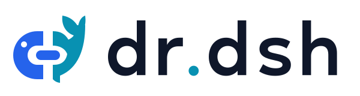

# dr.dsh

<picture>
  <source media="(prefers-color-scheme: dark)" srcset="assets/brand/logo-dark.svg">
  
</picture>

English | [中文](README.zh.md)

**Use the DeepSeek Harness on your computer from a phone or another computer's browser.**

DSH and your sessions stay on your computer. dr.dsh brings the real DSH interface to your browser,
with end-to-end encrypted traffic passing through a relay you host.

[Download v0.2.0](https://github.com/luckyuro/dr.dsh/releases/tag/v0.2.0) ·
[Install and upgrade](docs/operations/releases.md) · [Troubleshooting](docs/operations/troubleshooting.md)

## Choose how to run

Both options need a Relay. It serves the browser client; your DSH computer connects outbound,
so you do not expose a DSH port.

| What you need | Choose | When DSH closes |
| :--- | :--- | :--- |
| Automatic DSH installation, remote start/restart, or crash recovery | **Persistent Daemon**, using the quick start below | Daemon can still accept a start command |
| Remote access while your existing DSH is open | **[DSH plugin](daemon/README.md#manage-daemon-from-a-dsh-plugin)** with `relayUrl` configured | The plugin tunnel exits; restart DSH locally |

```text
Phone / browser ⇄ Relay (server + PWA) ⇄ Daemon or plugin tunnel (your computer) → DSH
```

Release packages support **Linux x86_64 (musl)** and **macOS Apple Silicon**. Linux offers Relay,
Daemon and mixed packages; macOS offers a Daemon package. The standalone plugin archive contains
native programs for both platforms. The DSH compatibility baseline is `0.2.2-alpha.2`, with regression
coverage for `0.2.1-rc.5`. Automatic installation pins the verified DSH and Cordis dependency combination;
see the [compatibility record](docs/integration/dsh-surface.md).

## Quick start

Use a Linux relay server and a DSH computer, or one Linux machine for both.
The installers need curl, tar, and sha256sum or shasum. The DSH computer also needs **Node 24.9+ and npm**.
Services require a Linux systemd user session or a macOS login session. No Rust, pnpm or repository clone
is needed. Configure your own model account or API key in DSH before running model tasks.

### 1. Install Relay

On the Linux relay server:

```sh
curl -fsSL https://raw.githubusercontent.com/luckyuro/dr.dsh/master/relay/install.sh | sh -s -- --start
export PATH="$HOME/.local/bin:$PATH"
drdsh relay status
```

`relay health: responding` means it is ready. The default listener is `127.0.0.1:8787`.
For phones and other computers, configure an HTTPS domain such as `https://relay.example.com` using
[DNS and a reverse proxy](relay/README.md#custom-domain), or [native TLS](docs/operations/tls.md).
`--bind` takes a listening IP and port, not a domain or WebSocket URL.

### 2. Install Daemon

On the DSH computer, replace the example domain with your relay:

```sh
curl -fsSL https://raw.githubusercontent.com/luckyuro/dr.dsh/master/daemon/install.sh | sh -s -- \
  --relay wss://relay.example.com --start
export PATH="$HOME/.local/bin:$PATH"
drdsh daemon status
```

A first installation downloads the pinned DSH runtime and bundled plugin. To use your existing DSH,
add `--dsh /absolute/path/to/dsh` with its **executable** path. Reinstallation retains saved paths and
settings. See [automatic DSH installation](docs/operations/dsh-provisioning.md) for ownership and data locations.

Common options:

| Option | Purpose |
| :--- | :--- |
| `--workdir /path/to/project` | Initial working directory; defaults to the current directory |
| `--port 3081` | Avoid a port already used by another DSH |
| `--enable` | Start at login; `--start` only controls this installation's immediate start |
| `--version v0.2.0` | Pin a Release; defaults to the latest version |
| `--prefix /path/to/install` | Change the installation directory; defaults to `~/.local` |

For a same-host trial, use `--relay ws://127.0.0.1:8787`. To install both components on one Linux
machine, use the [mixed package](docs/operations/releases.md#从-release-安装). Omit `--start` to install only.
Add `~/.local/bin` to your shell configuration to keep `drdsh` available in later terminals.

### 3. Pair and open DSH

Run on the DSH computer and leave the command waiting:

```sh
drdsh daemon pair
```

1. Open the relay's HTTPS address on the other device. For same-host testing, use the [local relay](http://127.0.0.1:8787).
2. Enter the code and click **Connect** or press Enter. Pairing saves the computer and connects automatically, showing Harness when DSH is running.
3. On later visits, select the saved computer, leave the code field empty and click **Connect**.

Codes allow one attempt and expire after about five minutes. Generate a new one after pairing fails
or expires. If the page says pairing was saved but the connection failed, restore DSH or the tunnel,
then reconnect with the field empty; no new code is needed.

The floating **dr** button opens connection controls, including reload, disconnect and computer selection.
Drag it to either edge. Closing the dialog preserves your session. One browser connection can use a
computer at a time; disconnect the old page before switching devices. The PWA supports English and
Simplified Chinese, remembers the choice per relay, and can switch languages offline.

## Everyday management

| Action | Relay server | DSH computer |
| :--- | :--- | :--- |
| Status | `drdsh relay status` | `drdsh daemon status` |
| Logs | `drdsh relay logs --follow` | `drdsh daemon logs --follow` |
| Start / stop / restart | `drdsh relay start / stop / restart` | `drdsh daemon start / stop / restart` |
| Login autostart | `drdsh relay enable` | `drdsh daemon enable` |
| Update | `drdsh relay update` | `drdsh daemon update` |
| Uninstall | `drdsh relay uninstall` | `drdsh daemon uninstall` |

`start / stop / restart` denotes three separate commands, such as `drdsh daemon restart`.
Each component has its own programs, configuration, services and logs. Updating or uninstalling one
does not restart the other. `disable` turns off autostart. Uninstalling keeps configuration, logs and
pairings. Relay updates include the PWA; if nginx serves it directly, also update its `client/` files.

The local DSH **dr.dsh 管理** page can authorize, install, configure, pair and maintain the daemon.
Pairing codes have a copy button; management authorization expires after 15 minutes. The page closes
with DSH, while submitted installation jobs continue through the OS service manager.
See the [plugin and management guide](daemon/README.md#manage-daemon-from-a-dsh-plugin).

## Before using it

- Keep the DSH computer awake and online. Remote browsers need HTTPS; localhost HTTP is for same-host testing.
- The optional plugin sends completion and approval notifications to connected pages. There is no offline push; approvals are handled in DSH.
- The relay distributes browser code, so its infrastructure must be trusted. There is no third-party audit, independent signature or official hosted relay.
- Review the [release notes](docs/operations/releases.md) and [security boundaries](docs/security.md) before upgrading. Older unified installations have a [migration guide](docs/operations/cli.md#从旧版安装迁移).

## Documentation and development

- [Relay guide](relay/README.md), [Daemon guide](daemon/README.md), [documentation index](docs/README.md).
- [Architecture](docs/architecture.md), [design decisions](docs/decisions/README.md), [contributing](docs/development/contributing.md), [repository rules](AGENTS.md).

```sh
pnpm install
pnpm run verify
```

MIT license.
